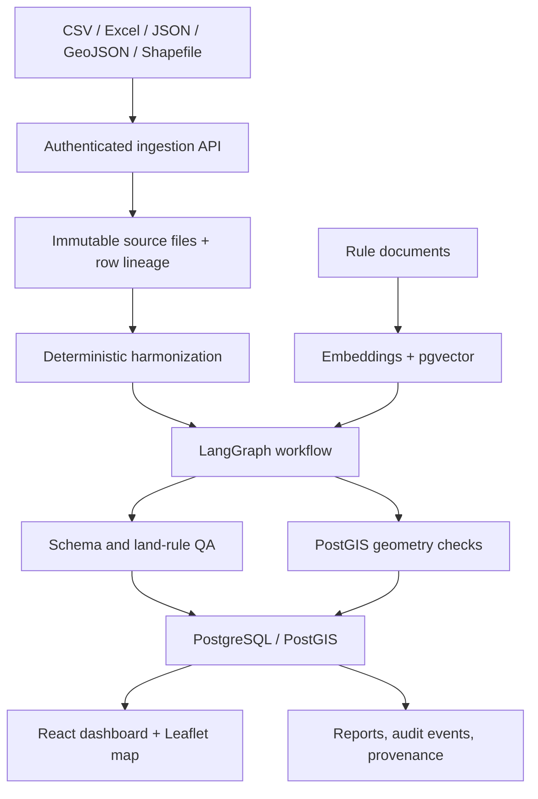

# Multi-Source Land-Data Harmonization Agent

**LandSync** is a geospatial data platform for ingesting, harmonizing, validating, and reviewing land-record datasets from multiple source formats. It combines deterministic data transformations, spatial validation, retrieval-assisted rule references, and auditable agent workflows.

> **Dataset notice:** Included sample records are synthetic and fictional. They are not government land records.

## Problem and objective

Land datasets often arrive in different file formats, with inconsistent column names, area units, coordinate reference systems, and record identifiers. Comparing them directly can lead to duplicate records, mismatched parcels, and difficult-to-trace corrections.

This project provides a repeatable workflow to preserve source data, standardize records, identify quality issues, and make the results reviewable.

## Key capabilities

- **Multi-format ingestion:** CSV, Excel, JSON, GeoJSON, and zipped Shapefile uploads.
- **Source lineage:** Original uploads, hashes, metadata, and raw-row lineage are retained.
- **Deterministic harmonization:** Alias-based field mapping, area normalization to acres, and CRS conversion to EPSG:4326.
- **Quality assurance:** Canonical-schema checks, domain rules, geometry validation, and polygon-overlap checks.
- **Conflict review:** Duplicate and conflict candidates with row-level transformation provenance.
- **Agent orchestration:** LangGraph workflow with checkpoints, retry handling, and auditable execution status.
- **Knowledge retrieval:** Workspace-scoped rule-document indexing with embeddings and pgvector retrieval.
- **Geospatial interface:** React Leaflet map with parcel selection and status/search filters.
- **Reporting and audit:** Job-level JSON, CSV, and PDF reports with provenance, validation findings, and audit events.
- **Workspace isolation:** Authenticated workspaces and protected API routes.

## Architecture



## Technology stack

| Layer | Technologies |
|---|---|
| Frontend | React, dashboard UI, React Leaflet |
| API | Python, FastAPI |
| Agent workflow | LangGraph |
| Retrieval | Gemini embeddings, LangChain integration, pgvector |
| Data platform | PostgreSQL 17, PostGIS 3.7, SQLAlchemy, Alembic |
| Validation | Pandera, deterministic domain rules, spatial validation |
| Background jobs | Celery, Redis |
| Authentication | JWT, Argon2 |
| Deployment | Docker Compose, Nginx |
| Optional observability | OpenTelemetry, Langfuse |

## Project documentation

- [Architecture and initial design](docs/architecture.md)
- [Architecture, data model, and API reference](docs/architecture-and-data-model.md)
- [Demo walkthrough, interview Q&A, and resume summary](docs/demo-and-interview-guide.md)
- [Render deployment guide and cost estimate](docs/deployment-render.md)

## Run locally

**Prerequisites:** Docker Desktop with Compose support, Git, and a supported Windows/WSL2, macOS, or Linux environment. For the documented local Python setup, use the Python version pinned/tested by the repository's current requirements.

1. Clone the repository:

   ```bash
   git clone https://github.com/SonuKumar-suman09/Multi-Source-Land-Data-Harmonization-Agent.git
   cd Multi-Source-Land-Data-Harmonization-Agent
   ```

2. Create your local environment file:

   ```bash
   cp .env.example .env
   ```

   Set a unique `JWT_SECRET_KEY` (at least 32 characters) and replace sample credentials for any shared environment. Never commit `.env`.

3. Start the application:

   ```bash
   docker compose up --build -d
   docker compose ps
   ```

4. Wait for the database, Redis, API, and frontend health checks to pass and for the migration service to complete. The documented local defaults are:

   - Dashboard: [http://localhost:8080](http://localhost:8080)
   - API documentation: [http://localhost:8001/docs](http://localhost:8001/docs)

For a manual backend setup, fixture generation, database verification, and troubleshooting, follow [the architecture and demo guides](docs/architecture-and-data-model.md).

## Screenshots and demo

No screenshot assets are currently committed in the repository, so this README does not embed placeholder images. The [demo walkthrough](docs/demo-and-interview-guide.md) documents the expected flow. Add genuine screenshots or a short recording after capturing the running application.

## Data and security notes

- Sample parcel and land records are synthetic.
- Gemini mapping suggestions are optional and require explicit consent; the application documentation states that only column headers are sent for those suggestions.
- Keep API keys, JWT secrets, database passwords, and uploaded user data out of Git.
- Treat automated matches and QA findings as review assistance; a human should verify important land-record decisions.

## Author

**Sonu Kumar Suman** · [GitHub](https://github.com/SonuKumar-suman09) · [Portfolio](https://sonu123.vercel.app/)
