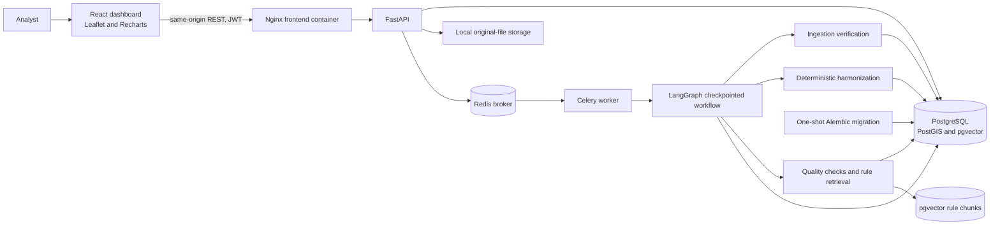
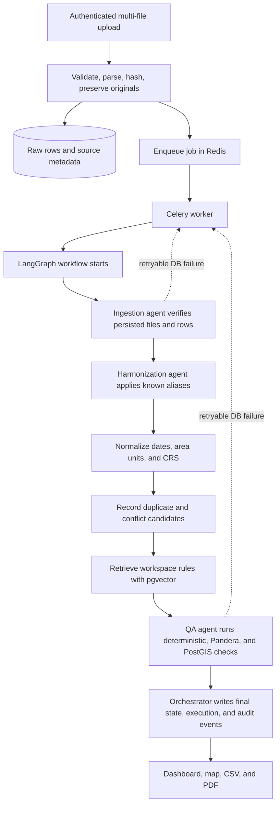

# Architecture and data model

This document describes the running implementation. All example land records in this repository are synthetic.

## System architecture



## Agent workflow



The upload endpoint parses files and stores raw rows before enqueuing. The graph's ingestion node verifies those persisted rows; it does not parse the files a second time. The harmonization and QA steps are deterministic. QA retrieves applicable knowledge-base chunks when available. Gemini can create embeddings for the knowledge base when configured. Optional Gemini schema suggestions are also implemented: only column headers are sent after the user explicitly consents, and a person must review and save mapping decisions before processing.

## Database ER diagram

```mermaid
erDiagram
  USERS ||--o{ WORKSPACE_MEMBERSHIPS : joins
  USERS ||--o{ REVOKED_TOKENS : signs_out
  WORKSPACES ||--o{ WORKSPACE_MEMBERSHIPS : contains
  WORKSPACES ||--o{ DATA_SOURCES : owns
  WORKSPACES ||--o{ PROCESSING_JOBS : owns
  WORKSPACES ||--o{ UPLOADED_FILES : scopes
  WORKSPACES ||--o{ RAW_LAND_RECORDS : scopes
  WORKSPACES ||--o{ HARMONIZED_LAND_RECORDS : scopes
  WORKSPACES ||--o{ LAND_DATA_RULES : contains
  WORKSPACES ||--o{ AUDIT_LOGS : records
  USERS o|--o{ PROCESSING_JOBS : requests
  DATA_SOURCES ||--o{ UPLOADED_FILES : describes
  PROCESSING_JOBS ||--o{ UPLOADED_FILES : receives
  UPLOADED_FILES ||--o{ RAW_LAND_RECORDS : parses
  PROCESSING_JOBS ||--o{ RAW_LAND_RECORDS : groups
  PROCESSING_JOBS ||--o{ HARMONIZED_LAND_RECORDS : produces
  PROCESSING_JOBS ||--o{ SCHEMA_MAPPINGS : records
  DATA_SOURCES ||--o{ SCHEMA_MAPPINGS : maps
  HARMONIZED_LAND_RECORDS ||--o{ RECORD_PROVENANCE : traces
  RAW_LAND_RECORDS ||--o{ RECORD_PROVENANCE : originates
  SCHEMA_MAPPINGS o|--o{ RECORD_PROVENANCE : explains
  PROCESSING_JOBS ||--o{ VALIDATION_RESULTS : reports
  HARMONIZED_LAND_RECORDS o|--o{ VALIDATION_RESULTS : flags
  RAW_LAND_RECORDS o|--o{ VALIDATION_RESULTS : identifies
  LAND_DATA_RULES o|--o{ VALIDATION_RESULTS : informs
  PROCESSING_JOBS ||--o{ DUPLICATE_RECORDS : groups
  HARMONIZED_LAND_RECORDS ||--o{ DUPLICATE_RECORDS : candidate_a
  HARMONIZED_LAND_RECORDS ||--o{ DUPLICATE_RECORDS : candidate_b
  PROCESSING_JOBS ||--o{ AGENT_EXECUTIONS : tracks
  PROCESSING_JOBS ||--o| WORKFLOW_STATES : checkpoints
  USERS o|--o{ AUDIT_LOGS : acts

  USERS {
    uuid id PK
    string email UK
    string password_hash
    string role
  }
  REVOKED_TOKENS {
    uuid token_id PK
    uuid user_id FK
    datetime expires_at
    datetime revoked_at
  }
  WORKSPACES {
    uuid id PK
    string name
    string slug UK
  }
  WORKSPACE_MEMBERSHIPS {
    uuid id PK
    uuid workspace_id FK
    uuid user_id FK
    string role
  }
  DATA_SOURCES {
    uuid id PK
    uuid workspace_id FK
    string name
    string jurisdiction
  }
  PROCESSING_JOBS {
    uuid id PK
    uuid workspace_id FK
    uuid requested_by FK
    string status
    jsonb config
  }
  UPLOADED_FILES {
    uuid id PK
    uuid source_id FK
    uuid job_id FK
    string sha256
    string object_key
  }
  RAW_LAND_RECORDS {
    uuid id PK
    uuid uploaded_file_id FK
    uuid job_id FK
    integer row_number
    jsonb original_data
  }
  HARMONIZED_LAND_RECORDS {
    uuid id PK
    uuid job_id FK
    string plot_id
    numeric area_acres
    geometry geometry_4326
    string status
  }
  SCHEMA_MAPPINGS {
    uuid id PK
    uuid job_id FK
    uuid source_id FK
    string source_column
    string canonical_field
    string status
  }
  RECORD_PROVENANCE {
    uuid id PK
    uuid harmonized_record_id FK
    uuid raw_record_id FK
    uuid schema_mapping_id FK
    jsonb transformation_history
  }
  LAND_DATA_RULES {
    uuid id PK
    uuid workspace_id FK
    string rule_key
    string version
    vector embedding
  }
  VALIDATION_RESULTS {
    uuid id PK
    uuid job_id FK
    uuid harmonized_record_id FK
    uuid raw_record_id FK
    uuid rule_id FK
    string severity
  }
  DUPLICATE_RECORDS {
    uuid id PK
    uuid job_id FK
    uuid record_a_id FK
    uuid record_b_id FK
    numeric similarity_score
  }
  AGENT_EXECUTIONS {
    uuid id PK
    uuid job_id FK
    string agent_name
    string status
    integer attempt
  }
  WORKFLOW_STATES {
    uuid id PK
    uuid job_id FK UK
    string graph_thread_id UK
    jsonb state_summary
  }
  AUDIT_LOGS {
    uuid id PK
    uuid workspace_id FK
    uuid actor_id FK
    string action
    uuid object_id
  }
```

## API reference

Interactive OpenAPI documentation is available at `http://localhost:8001/docs` when the Docker stack is running. Health checks are public; other endpoints below require a bearer JWT and are workspace-scoped.

| Method | Path | Purpose |
| --- | --- | --- |
| `POST` | `/api/v1/auth/register` | Create an analyst account and personal workspace. |
| `POST` | `/api/v1/auth/login` | Verify credentials and issue a short-lived JWT. |
| `POST` | `/api/v1/auth/logout` | Revoke the current JWT immediately and record a workspace audit event. |
| `GET` | `/api/v1/auth/me` | Read the signed-in user's profile. |
| `PATCH` | `/api/v1/auth/me` | Update the profile display name and write a workspace audit event. |
| `GET` | `/api/v1/dashboard/summary` | Get workspace counts and recent processing jobs. |
| `POST` | `/api/v1/ingestion/uploads` | Ingest one or more CSV, Excel, JSON, GeoJSON, or zipped Shapefile files. |
| `GET` | `/api/v1/ingestion/jobs/{job_id}` | Read stored file and row summaries. |
| `POST` | `/api/v1/harmonization/jobs/{job_id}/run` | Apply deterministic schema mapping and transformations. |
| `POST` | `/api/v1/quality/jobs/{job_id}/run` | Run QA rules and return findings and quality score. |
| `POST` | `/api/v1/workflows/jobs/{job_id}/run` | Run the checkpointed workflow synchronously. |
| `POST` | `/api/v1/workflows/jobs/{job_id}/enqueue` | Queue the workflow for Celery and return HTTP 202. |
| `GET` | `/api/v1/workflows/jobs/{job_id}` | Read durable workflow state. |
| `GET` | `/api/v1/map/parcels` | Get workspace parcel GeoJSON with status/search/bounds filters. |
| `POST` | `/api/v1/knowledge/documents` | Index an authenticated workspace rule document. |
| `GET` | `/api/v1/knowledge/documents` | List indexed rule documents. |
| `POST` | `/api/v1/knowledge/search` | Search indexed rules using pgvector. |
| `GET` | `/api/v1/reports/jobs/{job_id}` | Read processing metrics, findings, agent runs, and audit events. |
| `GET` | `/api/v1/reports/jobs/{job_id}/csv` | Download canonical values with source-row provenance. |
| `GET` | `/api/v1/reports/jobs/{job_id}/pdf` | Download a human-readable processing report. |
| `GET` | `/health/live` | Check API process liveness. |
| `GET` | `/health/ready` | Check API, PostgreSQL, and Redis readiness. |

