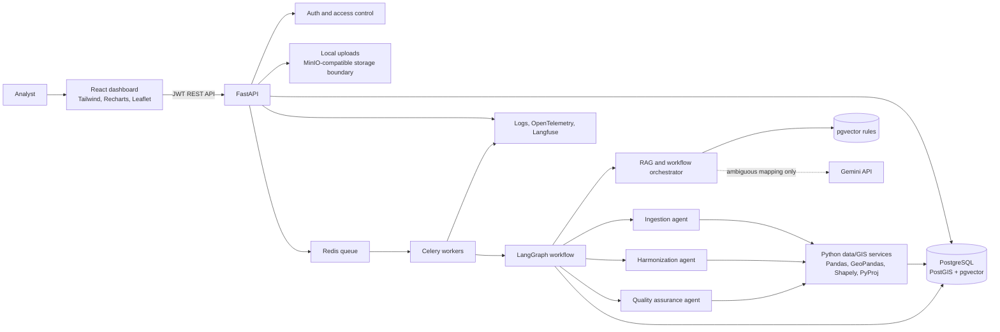

# Multi-Source Land-Data Harmonization Agent

## Phase 1: System architecture

This document defines the first implementation target. The platform accepts synthetic or user-provided land datasets, preserves their original files, maps their schemas into a canonical record model, validates attributes and geometry, records lineage, and presents reviewable results. Land data can affect ownership and legal decisions, so the system treats automated mappings and corrections as proposals with evidence; it does not silently overwrite critical source values.

## 1. Architecture at a glance



### Service boundaries

- **React frontend:** upload and monitor jobs, inspect proposed mappings and validation findings, approve uncertain mappings, browse records on a map, and download reports. It never contains provider secrets.
- **FastAPI API:** authentication, upload validation, job creation/status, review actions, record/query endpoints, knowledge-base administration, and report downloads. It validates requests and enforces user/workspace access.
- **Celery workers:** process potentially large files outside the request cycle. Redis carries task messages; task status and durable workflow state live in PostgreSQL.
- **LangGraph:** coordinates typed workflow state, agent steps, human-review pauses, retryable failures, and checkpointing. Agents call deterministic services for parsing, transforms, and validation.
- **PostgreSQL/PostGIS/pgvector:** system of record for users, source and job metadata, raw and harmonized record attributes, geometries, rules, provenance, audit history, and vector embeddings.
- **File storage:** originals are immutable and stored by generated object key, with checksum and metadata in PostgreSQL. Development uses a local storage adapter; MinIO can implement the same interface later.

## 2. Canonical record and provenance

The initial canonical land record should include a stable internal UUID, `plot_id`, `owner_name`, `area_acres`, source dates, normalized attributes, geometry (EPSG:4326 for display/query interchange), and processing status. Source CRS and original coordinate/geometry representation remain recorded so re-projection is traceable. Do not assume plot identifiers are globally unique; uniqueness is scoped to a source or jurisdiction where known.

Each parsed raw row is associated with its uploaded file, source, row number or source key, original values, and ingestion job. A harmonized record links back to one or more raw rows through a provenance/link table. Store both original and normalized values, mapping decisions, transform version, and timestamps. Duplicate detection creates candidate groups and similarity evidence; it does not delete records. Conflicts remain visible for review.

## 3. Four specialized agents

### Agent 1 — Data ingestion

Detects the format from the file content and validated extension, records checksum/size/source metadata, and parses CSV, Excel, JSON, GeoJSON, and Shapefile bundles. It reports encoding, sheet/layer names, row counts, columns, CRS when available, missing fields, malformed rows, and parser warnings. It never mutates the original upload. Parsing uses bounded file/row limits and isolated temporary working directories. Unsupported or unsafe inputs fail with a user-readable error and an audit event.

### Agent 2 — Data harmonization

First applies versioned deterministic aliases, type parsers, unit conversions, date parsers, and CRS transforms. It can propose mappings from column names and sampled values. Only genuinely ambiguous mappings are sent to Gemini, with the allowed canonical fields and evidence; the proposal includes confidence, rationale, and source columns. Low-confidence or critical-field proposals pause for human review. Accepted mappings are saved with actor, timestamp, and mapping version. Duplicate candidates and attribute conflicts are reported, never silently merged.

### Agent 3 — Data quality assurance

Checks required/optional values, identifier shape, finite positive area and unit, coordinate bounds, geometry validity/type, CRS conversion, duplicate candidates, and cross-source ownership/area inconsistencies. Pandera validates tabular frames; Pydantic validates API/state structures; Shapely/GeoPandas validate geometries; PostGIS provides indexed spatial predicates and persisted geometry checks. Findings are categorized as critical errors, warnings, or informational issues, with row provenance and suggested action. QA does not alter a critical value to make it pass.

### Agent 4 — RAG and workflow orchestrator

Runs the LangGraph state machine and coordinates the preceding steps. It retrieves versioned, access-controlled rules and schema guidance from PostgreSQL/pgvector, recording the rule IDs and text versions used for a run. It handles checkpoints, retry policy for transient failures, final report assembly, and transitions to human review. Gemini is optional for mapping proposals; deterministic/mock mode supports local demonstrations without a key. Retrieved rules inform validation but never override deterministic safety checks.

## 4. End-to-end workflow

1. Authenticated user uploads one or more files. API checks type, size, workspace access, and upload limits; stores originals and creates source/file/job rows.
2. API returns a job ID immediately and enqueues a Celery task. The dashboard polls or subscribes to job status (initial milestone: polling).
3. Ingestion inspects and parses each file, writes raw rows and metadata, and emits a structured ingestion report.
4. Schema profiling proposes mappings using deterministic aliases and type/value evidence. Ambiguous mappings are marked `needs_review`; user approval becomes an audited workflow input.
5. Harmonization normalizes accepted fields, units, dates, and CRS into the canonical model while retaining raw values and transformation history.
6. Orchestrator retrieves applicable rules from the RAG knowledge base. Rule sources and versions are attached to the run.
7. QA validates records and generates row-level findings, duplicate candidates, conflict candidates, and a quality score with documented weighting.
8. Recoverable infrastructure errors retry with bounded exponential backoff. Data errors are recorded and the workflow continues where safe. Review-required decisions pause rather than guessing.
9. Accepted and flagged harmonized records, geometries, findings, provenance links, agent events, and final job status are committed transactionally in batches.
10. Dashboard shows counts, agent states, records, findings, and map layers. CSV report is the first export; PDF can follow after core data correctness is established.

## 5. Workflow states and failure handling

Suggested job lifecycle: `queued → ingesting → mapping → awaiting_review (optional) → harmonizing → validating → completed | completed_with_errors | failed | cancelled`.

Each agent step records start/end time, attempt, input/output references, status, and sanitized error details. Retry only transient failures (temporary database/network/service errors); malformed files, invalid values, and rejected mappings are not retried automatically. Use idempotency keys derived from job, file checksum, and processing version so a worker retry does not create duplicate outputs. LangGraph checkpoints support resumption; PostgreSQL remains the durable source of job status. Never put API keys, raw credentials, or unnecessary personal data into logs or traces.

## 6. Database architecture

Use SQLAlchemy 2.x and Alembic migrations. UUID primary keys, UTC timestamps, explicit foreign keys, and workspace scoping are used throughout. Add PostGIS GiST indexes on geometry and pgvector indexes only after selecting an embedding dimension/model and validating the installed extension version.

| Table | Purpose and important relationships |
|---|---|
| `users` | Login identity, password hash, role, active flag. |
| `workspaces` | Tenant/security boundary; owns sources, jobs, rules, and records. |
| `data_sources` | Origin label, jurisdiction, CRS/default units, creator, workspace. |
| `uploaded_files` | Original object key, checksum, media type, size, detected format, source, job. |
| `processing_jobs` | User request, lifecycle status, config/version, summary and timestamps. |
| `raw_land_records` | Original row payload, source row number/key, file, parse status; indexed by job/file. |
| `harmonized_land_records` | Canonical fields, geometry, review/QA status, workspace and job. |
| `record_provenance` | Many-to-many links from harmonized record to raw records, with transform/mapping references. |
| `schema_mappings` | Source-to-canonical field decisions, confidence, evidence, version, approval actor/time. |
| `validation_results` | Rule, severity, message, suggested action, raw/harmonized record references. |
| `duplicate_records` | Candidate pair/group, method, score/evidence, review status; no destructive merge. |
| `agent_executions` | Per-step/agent attempt, state, timing, sanitized error, trace correlation. |
| `workflow_states` | LangGraph checkpoint/thread metadata and versioned state references. |
| `audit_logs` | Append-only actor/action/object/time/details for uploads, approvals, and exports. |
| `land_data_rules` | Rule documents/chunks, scope, version, source, active dates, embedding vector. |

Important constraints include unique user email, unique checksum/object key per workspace where appropriate, nonnegative file size, valid status/severity enums, finite positive normalized area where present, and foreign keys that prevent orphan lineage. Use JSONB for source-specific/raw payloads and flexible reports, not as a replacement for queryable canonical columns. Store geometry as a PostGIS geometry with SRID and validate it before persistence. Use database transactions for each output batch and audit approval.

## 7. Security, privacy, and operational requirements

- Hash passwords with Argon2id; JWTs have short expiry and configured signing secrets. Keep refresh-token policy and revocation behavior explicit.
- Enforce workspace and role authorization on every data/report/rule endpoint. Do not trust workspace IDs supplied by the browser.
- Allowlist formats and enforce upload, archive expansion, row, and request-size limits. Shapefile uploads require safe archive extraction; reject path traversal and decompression bombs.
- Keep credentials in environment variables or deployment secrets. `.env.example` contains placeholders only; `.env` and uploaded data are ignored by Git.
- Apply structured logs with request/job/trace IDs and redact tokens, credentials, and unnecessary owner data. Record consequential actions in append-only audit events.
- Configure database least privilege, TLS outside local development, CORS allowlist, and backup/restore procedures before production use.
- Observability starts with Python structured logging and OpenTelemetry trace IDs. Langfuse is optional/configurable and receives sanitized prompts and traces only.

## 8. Folder structure

```text
.
├── backend/
│   ├── app/
│   │   ├── agents/          # Agent boundaries and LangGraph nodes
│   │   ├── api/             # Versioned FastAPI routers and dependencies
│   │   ├── core/            # Settings, auth, logging, errors
│   │   ├── database/        # Engine, sessions, migrations support
│   │   ├── models/          # SQLAlchemy models
│   │   ├── schemas/         # Pydantic request/response/state contracts
│   │   ├── services/        # Ingestion, harmonization, QA, report services
│   │   ├── gis/             # CRS, geometry, spatial operations
│   │   ├── rag/             # Chunking, embeddings, retrieval, rule filters
│   │   ├── tasks/           # Celery app and task definitions
│   │   ├── storage/         # Local and MinIO storage adapters
│   │   ├── utils/
│   │   └── main.py
│   ├── alembic/             # Versioned schema migrations
│   ├── tests/
│   ├── requirements.txt
│   └── Dockerfile
├── frontend/
│   ├── src/
│   │   ├── components/ pages/ layouts/ services/ hooks/
│   │   ├── maps/ charts/ utils/
│   │   └── main.jsx
│   ├── package.json
│   └── Dockerfile
├── data/
│   ├── sample/              # Synthetic fixtures only
│   ├── uploads/              # Local dev data; Git-ignored
│   └── processed/            # Local dev outputs; Git-ignored
├── knowledge_base/
│   ├── rules/ schemas/ documents/  # Versioned demo/reference materials
├── docs/                    # Architecture, diagrams, API/demo guidance
├── docker-compose.yml
├── .env.example
├── .gitignore
└── README.md
```

## 9. Technology and external requirements

| Area | Required software/service | Credentials or configuration |
|---|---|---|
| Backend | Python 3.11+, pip, FastAPI, Pydantic, SQLAlchemy, Alembic | `DATABASE_URL`, JWT secret, allowed origins |
| Data/GIS | Pandas, NumPy, OpenPyXL, Pandera, GeoPandas, Shapely, PyProj; GDAL native libraries as needed | CRS identifiers and upload limits |
| Database | PostgreSQL with PostGIS and pgvector extensions | Database name/user/password; local Docker service |
| Agent/RAG | LangGraph, LangChain, Gemini integration and embedding model | Optional Gemini API key/model names; mock mode without credentials |
| Async | Redis and Celery | Redis URL, retry/time-limit configuration |
| Frontend | Node.js LTS, React, Vite, Tailwind CSS, Leaflet, Recharts | API base URL; no secrets |
| Storage | Local filesystem for development; MinIO when enabled | Root/bucket and MinIO endpoint/access keys |
| Observability | Python logging, OpenTelemetry; optional Langfuse | Optional OTLP/Langfuse endpoint and keys |
| Delivery | Docker, Docker Compose, Git | Environment-specific secrets supplied at deploy time |

External API use is limited to Gemini when enabled. Local deterministic mode must support ingestion, known schema mappings, validation, sample workflows, and dashboard operation without paid API access. RAG embeddings may use the configured Gemini embedding model; tests and local no-key mode should use a clearly labeled deterministic test embedding strategy or disable vector search, never pretend that mock vectors are semantic results.

## 10. Development roadmap and acceptance gates

| Phase | Deliverable | Gate before moving on |
|---|---|---|
| 1. Architecture | This document, boundaries, schema and workflow decisions | Scope and interfaces are clear. |
| 2. Environment/setup | Directories, env template, dependency pins, sample synthetic datasets | Clean setup instructions; no secrets or real personal data committed. |
| 3. Database | Compose PostgreSQL/PostGIS/pgvector, SQLAlchemy, Alembic, core tables | Migrations create schema; extension and spatial types verified. |
| 4. API/auth | FastAPI health/auth/workspace/job foundations | Password/JWT flows and access checks work. |
| 5. Ingestion | Safe CSV/XLSX/JSON/GeoJSON/Shapefile parsing and provenance | Synthetic fixtures produce inspectable reports; malformed files fail safely. |
| 6. Harmonization | Deterministic mapping, normalization, CRS transformation, review proposals | Multiple source fixtures produce canonical records and mapping evidence. |
| 7. QA | Pandera/Pydantic/geometry rules, severity reports, score | Invalid, missing, duplicate, and conflicting cases are surfaced without silent edits. |
| 8. LangGraph | Typed multi-agent graph, state, checkpoints, failure paths | End-to-end run resumes and records each agent execution. |
| 9. RAG | Rule ingestion, versioning, embeddings, pgvector retrieval | Queries return scoped rule references; no-key mode is explicit. |
| 10. Async | Celery/Redis job processing, bounded retries, idempotency | API returns promptly and worker results persist across restart. |
| 11. Dashboard | React auth, overview, upload, monitoring, quality and report screens | Real API data drives visible states and errors. |
| 12. GIS | Leaflet parcel layers and detail/filter views | Stored geometries render with correct CRS and provenance. |
| 13. Reports/observability | CSV/PDF exports, audit history, traces and timing | Exports reconcile to job results; secrets and sensitive fields are redacted. |
| 14. Testing/debugging | Pytest unit/integration/API/auth coverage and frontend checks | Critical path passes against documented local services. |
| 15. Deployment | Multi-service Docker Compose and operational defaults | Fresh environment runs from documented commands and health checks. |
| 16. Presentation | README, diagrams, demo script, interview Q&A and resume summary | Claims match implemented behavior; no invented benchmark numbers. |

### Phase 2 exact setup commands

From the project root in VS Code PowerShell, create the skeleton and Python virtual environment. Database and application dependencies are installed in their own phases. Any Python 3.11 or newer interpreter is supported by the project plan.

```powershell
New-Item -ItemType Directory -Force backend, frontend, data, knowledge_base, docs | Out-Null
New-Item -ItemType Directory -Force backend/app/agents, backend/app/api, backend/app/core, backend/app/database, backend/app/models, backend/app/schemas, backend/app/services, backend/app/gis, backend/app/rag, backend/app/tasks, backend/app/storage, backend/app/utils, backend/alembic, backend/tests, frontend/src, data/sample, data/uploads, data/processed, knowledge_base/rules, knowledge_base/schemas, knowledge_base/documents | Out-Null
python -m venv backend/.venv
```

Activate it for the current PowerShell session:

```powershell
.\backend\.venv\Scripts\Activate.ps1
python --version
```

Expected version output is Python 3.11 or newer. If the active `python` is older, install Python 3.11+ and create the environment with that interpreter. Install the Phase 2 bootstrap dependency and generate the Excel fixture:

```powershell
python -m pip install --upgrade pip
python -m pip install -r backend/requirements.txt
python data/sample/create_fixtures.py
```

For a quick setup check, run:

```powershell
python --version
python -m pip show openpyxl
python -c "import csv,json; from pathlib import Path; from openpyxl import load_workbook; p=Path('data/sample'); a=list(csv.DictReader((p/'source_a.csv').open(encoding='utf-8'))); c=json.loads((p/'source_c.geojson').read_text(encoding='utf-8'))['features']; w=load_workbook(p/'source_b.xlsx',read_only=True,data_only=True); ws=w['Parcels']; print('CSV='+str(len(a))+', XLSX='+str(ws.max_row-1)+', GeoJSON='+str(len(c))); assert len(a)==5 and ws.max_row-1==3 and len(c)==3"
```

The fixture check should print `CSV=5, XLSX=3, GeoJSON=3`. Phase 2 adds `.gitignore`, `.env.example`, the sample fixture generator, and synthetic source datasets. The generated Excel fixture can be recreated with `python data/sample/create_fixtures.py`.

### Phase 3: PostgreSQL/PostGIS/pgvector and data model

**What and why:** PostgreSQL stores durable source, job, record, quality, and audit data. PostGIS provides geometry storage and spatial indexes, while pgvector stores semantic rule embeddings beside the rules they represent. SQLAlchemy defines the application model and Alembic tracks schema versions so a fresh environment can recreate the database.

**Implemented files:** `docker-compose.yml` runs only the database service at this milestone; `database/Dockerfile` layers pgvector 0.8.7 onto the PostGIS 3.7 / PostgreSQL 17 image; `backend/app/models/entities.py` defines the initial 16-table schema; `backend/alembic/versions/0001_initial_schema.py` initializes extensions and materializes the baseline metadata. The vector column uses 768 dimensions, so the embedding provider must be configured to produce that size before indexing rules.

**Install commands:** Docker Desktop was installed from its official Winget package. On this machine its dashboard reports that Windows Virtual Machine Platform is disabled. The Docker engine cannot start until an administrator enables that Windows feature and restarts the computer. The user-facing steps and caveat are in `database/README.md`. Once the feature is enabled, run from the repository root:

```powershell
if (-not (Test-Path .env)) { Copy-Item .env.example .env }
docker compose build db
docker compose up -d db
docker compose ps
python -m pip install -r backend/requirements.txt
python -m pip install -r backend/requirements-dev.txt
alembic -c backend/alembic.ini upgrade head
```

If running the Python commands outside the activated virtual environment, call `backend\\.venv\\Scripts\\python.exe` instead of `python`, and `backend\\.venv\\Scripts\\alembic.exe` instead of `alembic`.

**Verification:** With the container running and the migration applied, the following queries should show PostGIS, vector extension 0.8.7, a 4326 geometry column, the `0001_initial_schema` revision, and the HNSW rule index:

```powershell
docker compose exec db psql -U land_app -d land_harmonizer -c "SELECT postgis_full_version();"
docker compose exec db psql -U land_app -d land_harmonizer -c "SELECT extversion FROM pg_extension WHERE extname = 'vector';"
docker compose exec db psql -U land_app -d land_harmonizer -c "SELECT f_geometry_column, srid, type FROM geometry_columns WHERE f_table_name = 'harmonized_land_records';"
docker compose exec db psql -U land_app -d land_harmonizer -c "SELECT version_num FROM alembic_version;"
docker compose exec db psql -U land_app -d land_harmonizer -c "SELECT indexname FROM pg_indexes WHERE tablename = 'land_data_rules';"
python -m pytest -q
```

The local checks completed so far: all five metadata tests pass, Python compilation passes, and Alembic generates PostgreSQL DDL offline. Live container, extension, geometry, and applied-migration checks are pending the Windows feature enablement and restart; Phase 4 should wait until those checks pass.

## 11. API and interface requirements

Initial REST API namespace: `/api/v1`. The first endpoint groups are:

- `GET /health` — service health and dependency status (without leaking connection details).
- `POST /auth/register`, `POST /auth/login`, `GET /auth/me` — account and token flows.
- `POST /sources`, `GET /sources` — workspace-scoped source metadata.
- `POST /jobs` — create a processing job and accept multiple upload files; returns job ID/status.
- `GET /jobs`, `GET /jobs/{job_id}` — list/detail status and aggregate report.
- `GET /jobs/{job_id}/agents` — step status and sanitized errors.
- `GET /jobs/{job_id}/records` — paginated harmonized records and filters.
- `GET /jobs/{job_id}/findings` — validation, duplicate, and conflict findings.
- `POST /jobs/{job_id}/mappings/{mapping_id}/decision` — approve/reject a proposed mapping with audit event.
- `GET /jobs/{job_id}/report.csv` — CSV report export; PDF is added with the reporting phase.
- `GET /records/geojson` — authorized map features with bounded viewport/filter parameters.
- `POST /knowledge/documents`, `GET /knowledge/documents`, `POST /knowledge/search` — manage and retrieve rule content.

All list endpoints need pagination and bounded filters. API schemas must distinguish raw source values, canonical values, confidence, review state, and QA findings. OpenAPI generated by FastAPI is the API reference; endpoint behavior and error formats will be documented as implemented.

## 12. Synthetic demonstration scenario

Phase 2 fixtures will represent three fictional sources: one CSV using `Khasra_No`/`Owner_Name`/acres and latitude-longitude; one Excel sheet using `Plot_Number`/`Landholder`/hectares and a projected CRS; and one GeoJSON source with parcel geometry and alternate date formats. Fixtures will intentionally include a repeated parcel candidate, one area conflict, missing owner/area values, a malformed date, and invalid geometry/coordinates. They are synthetic examples only and do not represent government records. The workflow should preserve all source rows and explain why each output record was accepted, flagged, or held for review.
